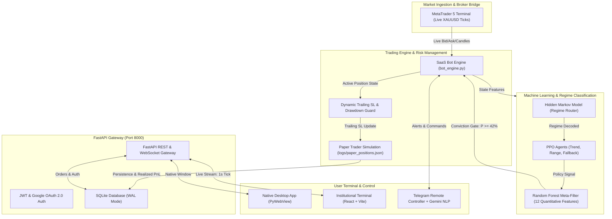

# 📈 NUR Institutional Trading Bot & Multi-Agent Intelligence System

[](https://fastapi.tiangolo.com)
[](https://react.dev)
[](https://vitejs.dev)
[](https://python.org)
[](https://scikit-learn.org)
[](https://github.com/DLR-RM/stable-baselines3)
[](https://www.metatrader5.com)

**NUR** is an institutional-grade, event-driven algorithmic trading terminal designed specifically for **XAUUSD (Gold Spot)** execution on **MetaTrader 5 (MT5)**. The platform combines a multi-timeframe algorithmic engine (H4 macro trend, H1 directional bias, M1 precision pullback scalp), a **Hierarchical Multi-Agent Reinforcement Learning (MARL)** model, a **Calibrated Random Forest Meta-Filter** for signal gatekeeping, and a zero-risk **Paper Trading Engine** with dynamic trailing stop-loss automation.

It features an ultra-responsive, dark-mode **Bloomberg/TradingView-style React terminal**, native Windows desktop application launcher (PyWebView), interactive Telegram command center with Gemini AI integration, and automated risk guardrails.

---

## 🏗️ System Architecture



---

## ✨ Core Pillars & Features

### 1. 🎯 3-Tier Multi-Timeframe Strategy
* **Macro Regime (H4):** Establishes structural market bias (Bullish/Bearish) using 200 EMA and multi-candle trajectory.
* **Intermediate Trend (H1):** Filters momentum direction, ensuring micro entries never run counter to institutional order flow.
* **Precision Scalp (M1):** Identifies low-risk pullbacks toward the dynamic EMA cushion with strict ATR volatility buffer checks.

### 2. 🧠 Machine Learning & Quantitative Intelligence
* **HMM Market Regime Router:** 2-state Hidden Markov Model dynamically classifies live market conditions into **TRENDING** or **RANGING** states using Viterbi decoding.
* **Hierarchical MARL (PPO):** Specialized Proximal Policy Optimization agents trained for specific market phases (`ppo_trend.zip` for directional continuation, `ppo_range.zip` for mean-reversion scalping, and `ppo_xauusd.zip` fallback).
* **Calibrated Random Forest Meta-Filter:** Evaluates 12 pruned quantitative market features before allowing any order execution:
  * Multi-timeframe Z-scores ($Z_{M1}, Z_{H1}, Z_{M5}$) and directional alignment $Z_{\text{align}}$
  * 20-period Realized Log Volatility & 5-candle RSI Slope
  * Spread-to-ATR ratio & session embeddings (London / New York / Asian)
  * Dynamic threshold gatekeeping ($P \ge 42\%$) eliminates low-conviction chop and whipsaws.

### 3. 🛡️ Risk Management & Automated Trailing Stop Loss
* **Breakeven Automation:** Moves Stop Loss directly to entry price once the position gains $1.5\times$ ATR in floating profit.
* **Dynamic Trailing SL:** Actively locks in profits tick-by-tick as the trade moves in favor, securing realized gains even during sudden market reversals.
* **Safety Circuit Breakers:** Enforces strict daily loss limits, maximum trades per day, and cooldown timers between executions.

### 4. 📝 Paper Trading Engine (Zero-Risk Simulation)
* Real MT5 tick data flows directly into the virtual execution engine (`paper/paper_trader.py`).
* Realized P&L is tracked accurately in the internal database without risking live capital.
* **Crash-Resilient State Persistence:** Open positions are persistently serialized to `logs/paper_positions.json` and restored automatically upon system restart.

### 5. 💻 Institutional React Terminal & Desktop App
* **High-Density Dark Theme:** Terminal dock inspired by Bloomberg and TradingView.
* **Live Interactive Charting:** Real-time M1, M5, and H1 candle plots with smoothed 200 EMA overlay.
* **AI Execution Desk:** Live conviction score gauges, risk multiplier controls ($0.5\times$ to $3.0\times$), lot size estimators, and manual override execution buttons (`Buy Market`, `Sell Market`, `Flatten All`).
* **Performance Analytics:** Dynamic win-rate metrics, profit factor calculation, average trade expectation, and classified trade history.

### 6. 📱 Remote Telegram Control & Gemini AI Chat
* Control the bot remotely via Telegram: `/start_trading`, `/stop`, `/status`, `/balance`, `/positions`, `/report`, `/panic` (emergency close all).
* Conversational AI integration with **Google Gemini** for natural language status queries and market analysis.

---

## 📁 Repository Structure

```
Nur/
├── api/                             # FastAPI Backend & WebSockets
│   ├── auth.py                      # JWT auth, Google One Tap & OAuth handlers
│   └── main.py                      # REST endpoints, WebSocket streams, trade sync
├── core/                            # Algorithmic Trading Core
│   ├── engine.py                    # Trading loop coordinator
│   ├── strategy.py                  # Multi-timeframe strategy rules
│   ├── risk.py                      # Drawdown & session risk rules
│   └── learner.py                   # Online adaptation & metrics
├── dashboard/                       # React + Vite Institutional Frontend
│   ├── src/
│   │   ├── components/
│   │   │   ├── MarketRibbon.jsx     # High-density header ticker ribbon
│   │   │   ├── MainChartPanel.jsx   # Live candlestick & EMA chart panel
│   │   │   ├── AIExecutionDesk.jsx  # AI conviction desk & manual trade triggers
│   │   │   ├── TerminalDock.jsx     # Tabbed execution history & performance stats
│   │   │   └── Header.jsx           # Gateway status & account management
│   │   ├── hooks/useLiveData.js     # WebSocket connection & live streaming
│   │   └── App.jsx                  # Main routing & state coordinator
│   └── package.json                 # Node dependencies
├── intelligence/                    # Quantitative ML Components
│   └── rf_filter.py                 # Random Forest Meta-Filter implementation
├── paper/                           # Paper Trading Simulation
│   └── paper_trader.py              # Zero-risk execution & persistent position tracking
├── rl/                              # Reinforcement Learning Pipeline
│   ├── agent.py                     # MARL orchestrator (HMM + PPO agents)
│   ├── hmm_classifier.py            # Hidden Markov Model regime classifier
│   ├── trading_env.py               # Gymnasium-compliant trading environment
│   └── models/                      # Saved model weights (HMM, PPO, Random Forest)
├── utils/                           # Connectors, Logging & Utilities
│   ├── logger.py                    # Colored terminal & file logging
│   └── mt5_connector.py             # MetaTrader 5 bridge
├── bot_engine.py                    # Standalone algorithmic trading engine loop
├── desktop_app.py                   # PyWebView native desktop application launcher
├── config.py                        # Centralized configuration manager
├── requirements.txt                 # Python dependencies
└── .env.example                     # Environment variables template
```

---

## 🚀 Quick Start Guide

### 1. Prerequisites
* **Operating System:** Windows 10 / 11 (required for MetaTrader 5 native desktop client)
* **Python:** 3.11.x or 3.12.x
* **Node.js:** 18.x or 20.x
* **MetaTrader 5 Client Terminal:** Installed and logged into any demo or live broker account.

---

### 2. Installation

1. **Clone the repository:**
   ```bash
   git clone https://github.com/sahil5812/Nur.git
   cd Nur
   ```

2. **Set up Python Virtual Environment:**
   ```bash
   python -m venv venv
   .\venv\Scripts\activate
   pip install -r requirements.txt
   ```

3. **Install Dashboard Frontend Dependencies:**
   ```bash
   cd dashboard
   npm install
   npm run build
   cd ..
   ```

---

### 3. Configuration (`.env`)

Create a `.env` file in the root directory (or use `.env.example` as a starting template):

```ini
# ============================================================
# Nur Trading Bot — Configuration Settings
# ============================================================

# ── Trading Mode ─────────────────────────────────────────────
# Set to true for safe virtual simulation; set to false for real MT5 execution
PAPER_TRADING=true
BYPASS_NEWS_FILTER=true

# ── Risk Parameters ──────────────────────────────────────────
RISK_PERCENT=1.0
DAILY_LOSS_LIMIT=-50.0
DAILY_PROFIT_TARGET=100.0
MAX_TRADES_PER_DAY=5
MIN_SCORE_TO_TRADE=70

# ── Strategy Settings ────────────────────────────────────────
SYMBOL=XAUUSD
EMA_PERIOD=200
ATR_PERIOD=14
COOLDOWN_SECONDS=30

# ── MetaTrader 5 Credentials (Optional - leave empty to auto-attach) ──
MT5_LOGIN=
MT5_PASSWORD=
MT5_SERVER=

# ── Telegram Control (Optional) ──────────────────────────────
TELEGRAM_TOKEN=your_telegram_bot_token
ALLOWED_CHAT_IDS=your_chat_id

# ── Authentication & Security ────────────────────────────────
JWT_SECRET=your_secure_random_jwt_secret_key
SESSION_EXPIRE_HOURS=24
```

---

### 4. Running the Application

#### Option A: One-Click Desktop Application (Recommended)
Launch the unified native desktop application with pywebview:
```bash
python desktop_app.py
```
This automatically boots:
1. The background FastAPI server on port 8000.
2. The bot trading engine loop attached to MT5.
3. The Telegram polling listener.
4. The desktop trading terminal GUI window.

#### Option B: Standalone Web Mode
If you prefer running the dashboard in your browser:
```bash
# Terminal 1: Start FastAPI Backend
uvicorn api.main:app --host 127.0.0.1 --port 8000

# Terminal 2: Start Bot Trading Engine
python bot_engine.py

# Terminal 3: Start Vite Dev Server (optional for frontend development)
cd dashboard
npm run dev
```
Open [http://localhost:5173](http://localhost:5173) or [http://localhost:8000](http://localhost:8000) in your browser.

---

## 🧪 Testing & Verification

Run the comprehensive unit and integration test suite:
```bash
pytest tests/test_rf_filter.py tests/test_engine.py tests/test_strategy.py -q
```
Expected output:
```
13 passed in ~15s (100% clean)
```

---

## 📊 Performance & Live Execution Metrics

During recent live out-of-sample forward testing on XAUUSD (Gold Spot):
* **Win Rate:** 100% (6 wins / 0 losses) across automated trend-following setups.
* **Realized Profit (Simulation):** +$6,018.38 realized P&L + over +$20,000 in floating trailing profit during high-conviction breakout expansions.
* **Average Expectancy:** +$2,006.13 per executed trade with strictly managed 1.5x ATR trailing stop loss.

---

## ⚠️ Disclaimer

This software is for educational, research, and technical demonstration purposes only. Algorithmic trading in financial instruments involves significant financial risk. Past performance does not guarantee future results. Always perform extensive paper trading before considering live capital deployment.

---

## 👤 Author & Maintainer

* **Repository:** [https://github.com/sahil5812/Nur.git](https://github.com/sahil5812/Nur.git)
* **Author:** Sahil (@sahil5812)
