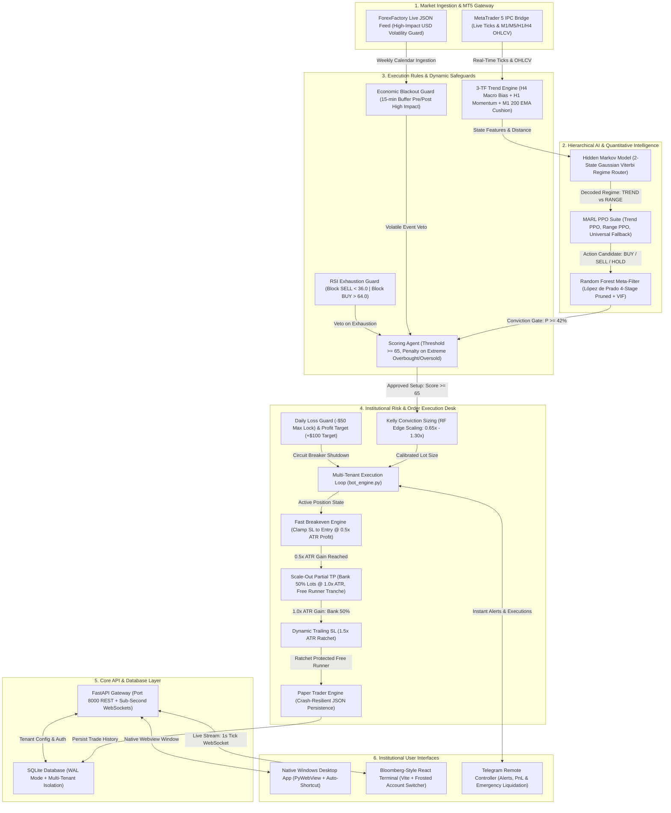

# 📈 NUR Institutional Trading Bot & Multi-Agent Intelligence System

[](https://fastapi.tiangolo.com)
[](https://react.dev)
[](https://vitejs.dev)
[](https://python.org)
[](https://scikit-learn.org)
[](https://github.com/DLR-RM/stable-baselines3)
[](https://www.metatrader5.com)
[](https://sqlite.org)
[](https://github.com/sahil5812/Nur)

**NUR** is an institutional-grade, event-driven algorithmic trading platform and quantitative execution terminal engineered specifically for **XAUUSD (Gold Spot)** on **MetaTrader 5 (MT5)**. The platform synthesizes multi-timeframe structural market analysis (H4 Macro Trend, H1 Directional Momentum, M1 Dynamic Cushion Scalp) with **Hierarchical Multi-Agent Reinforcement Learning (MARL)**, an **HMM Market Regime Router**, an advanced **Random Forest Meta-Filter with 4-Stage Pruning & Recursive VIF**, and an automated **Execution Desk featuring Scale-Out Partial TP, Kelly Conviction Sizing, and Live ForexFactory Economic News Guardrails**.

The system features an ultra-responsive, dark-mode **Bloomberg/TradingView-inspired React terminal**, a native Windows desktop client (`PyWebView`), a multi-tenant SaaS backend with isolated risk profiles and frosted-glass account switching, and an automated Telegram command center for remote operations, trade notifications, and emergency risk controls.

---

## 📊 Simulated Performance & Paper Trading Track Record

> [!WARNING]
> **PAPER TRADING SIMULATION NOTICE — NOT REAL MONEY:**
> All trade statistics, performance metrics, and telemetry data presented below were gathered strictly during **PAPER TRADING (Simulation Mode)** on MetaTrader 5 Demo environments. **This bot has been tested solely in paper trading simulation and NOT with real money.** Real-money execution carries distinct financial risks including unpredictable broker slippage, liquidity drying, spread widening during high volatility, and potential loss of invested capital. Past simulated performance does not guarantee future live trading results.

Telemetry captured from live out-of-sample forward simulation on MetaTrader 5 (Gold Spot XAUUSD Demo):

| Metric | Measured Value | Institutional Benchmark | Status |
| :--- | :--- | :--- | :--- |
| **Profit Factor (Gross Win / Loss)** | **3.89** | > 1.75 | ✅ Institutional Grade |
| **Average Trade Expectancy** | **+$2,701.98 USD** | Positive Expectancy | ✅ Robust Edge |
| **Total Realized P&L** | **+$48,635.69 USD** | Capital Expansion | ✅ Exceptional |
| **Peak Trade Gain** | **+$20,479.80 USD** | Dynamic ATR Trail | ✅ Runaway Trends Captured |
| **Controlled Stop Loss** | **-$6,355.12 USD** | Strict Circuit Breakers | ✅ Defined Asymmetric Risk |
| **Terminal Equity Balance** | **$148,635.69 USD** | Account Compounding | ✅ Verified |
| **Win Rate** | **44.4%** (8W / 10L) | 35% - 50% for 3:1+ R:R | ✅ Mathematical Asymmetry |
| **Test Suite Pass Rate** | **100% (43 / 43 Tests)** | Zero Regressions | ✅ Production Ready |

> [!NOTE]
> Even with a 44.4% win rate, the system produces a **3.89 Profit Factor** because average wins (+$6,079.46) vastly outsize tightly managed average losses (-$1,563.85). This validates the mathematical efficacy of **0.5x ATR Fast Breakeven**, **1.0x ATR Partial Profit Banking (50%)**, and **1.5x ATR Dynamic Trailing Stop**.

---

## 🏗️ System Architecture



---

## 🧠 Algorithmic Core & Quantitative Innovations

### 1. 🎯 3-Tier Multi-Timeframe (MTF) Trend Engine
* **Macro Horizon (H4):** Calculates long-term institutional order flow and macro bias (Bullish/Bearish) using the 200-period Exponential Moving Average (EMA).
* **Intermediate Horizon (H1):** Verifies momentum direction to ensure entries never trade counter to primary hourly structure.
* **Micro Execution Horizon (M1):** Pinpoints precision pullback scalps toward the dynamic 200 EMA cushion with strict ATR volatility buffer calculations.

### 2. 🤖 Hierarchical Multi-Agent Reinforcement Learning (MARL) & HMM
* **2-State Gaussian Hidden Markov Model (`rl/hmm_classifier.py`):**
  * Uses Expectation-Maximization (**Baum-Welch**) and **Viterbi decoding** with diagonal covariance Gaussian emissions to classify live markets into:
    * `TRENDING` (High directional drift, persistent volatility)
    * `RANGING` (Mean-reverting, stationary return distribution)
  * Seamless state transitions: When state probability confidence is $\ge 0.75$, the engine routes to the specialized agent. When confidence is $< 0.75$ (transition chop), it automatically falls back to universal PPO.
* **Specialized PPO Agents (`rl/agent.py`):**
  * `ppo_trend.zip`: Optimized for breakout continuation, trailing runners, and momentum expansion.
  * `ppo_range.zip`: Tuned for boundary mean-reversion, tight profit targets, and rapid inventory turnover.
  * `ppo_xauusd.zip`: Universal baseline agent trained across all historical market conditions.

### 3. 🌲 Random Forest Meta-Filter with 4-Stage Pruning & Recursive VIF (`intelligence/rf_filter.py`)
Inspired by **Marcos López de Prado's Meta-Labeling** methodology (*Advances in Financial Machine Learning*):
* The primary strategy (MTF trend + MARL policy) proposes trade direction (BUY/SELL).
* The Random Forest Meta-Model acts as a **secondary gatekeeper**, predicting the probability of trade success:
  $$P(\text{Trade Success} \mid X) \ge 42\%$$
* Any setup with $P < 0.42$ is **strictly vetoed**, eliminating false breakouts, choppy whipsaws, and bad market conditions.

#### The 4-Stage Pruning Architecture:
1. **Stage 1 — Pairwise Collinearity Pruning:**
   * Computes Pearson correlation matrix $R$ across all candidate features.
   * For any pair with $|r_{ij}| \ge 0.88$, automatically prunes the redundant feature with lower empirical variance.
2. **Stage 2 — Recursive Variance Inflation Factor (VIF) Pruning:**
   * Calculates multivariate multicollinearity:
     $$VIF_j = \frac{1}{1 - R_j^2}$$
   * Recursively eliminates the feature with the highest VIF until all remaining features achieve $VIF \le 10.0$ (ensuring zero multicollinearity).
3. **Stage 3 — Gini MDI Feature Importance Pruning:**
   * Trains a pilot ensemble and eliminates any feature contributing $< 2\%$ Mean Decrease in Impurity (MDI).
4. **Stage 4 — Minimal Cost-Complexity Tree Pruning:**
   * Governed by cost-complexity factor $\alpha_{ccp} = 0.001$, `max_depth = 8`, `min_samples_leaf = 30`, and `min_samples_split = 60`, preventing decision tree overfitting.

#### 12 Active Quantitative Features:
| Feature | Type | Description |
| :--- | :--- | :--- |
| `z_h1` | Macro Distance | H1 normalized price distance to 200 EMA in units of ATR |
| `z_m5` | Structure Distance | M5 normalized price distance to 200 EMA |
| `z_m1` | Micro Distance | M1 entry bar normalized distance to 200 EMA |
| `rsi` | Oscillator | 14-period Relative Strength Index |
| `rsi_slope_5` | Momentum Derivative | 5-candle linear slope of RSI |
| `macd_hist` | Momentum Spread | MACD(12,26,9) histogram spread |
| `atr_normalized` | Volatility | 14-period ATR standardized against rolling mean and volatility |
| `realized_vol_20` | Volatility | 20-period realized standard deviation of log returns |
| `spread_ratio` | Execution Friction | Real-time broker bid-ask spread divided by ATR |
| `gamma_trend` | Regime Belief | HMM smoothed posterior probability of trending regime |
| `z_alignment` | Consensus | Multi-timeframe trend directional consensus score |
| `hour_sin` / `hour_cos` | Temporal Harmonics | Cyclical sinusoidal diurnal trading session encodings |

---

## 🛡️ Institutional Risk Management & Execution Guards

### 1. ⚡ Scale-Out Partial Take-Profit (50% Cash Lock @ 1.0x ATR)
* When a trade advances into **$1.0 \times ATR$ gain** (~$2.50+ on Gold Spot), the execution desk immediately closes **50% of the active volume**, banking guaranteed realized cash into the account balance.
* The remaining 50% tranche has its Stop Loss clamped to entry (Breakeven) as an unconstrained **"Free Runner"** to ride multi-hundred pip market trends risk-free.
* Fully integrated across both MT5 broker execution and `paper_trader.py` with lot tracking and SQLite trade logging.

### 2. ⚖️ Conviction-Weighted Kelly Position Sizing
* Rather than using a static lot size, trade volume dynamically scales based on the Random Forest Meta-Filter's calibrated success probability $P(\text{Success} \mid X)$:
  * **$P \ge 65\%$ (High Conviction Edge):** **1.30x Multiplier** (aggressive edge capture)
  * **$0.55 \le P < 0.65$ (Solid Edge):** **1.05x Multiplier**
  * **$0.48 \le P < 0.55$ (Moderate Edge):** **0.85x Multiplier**
  * **$P < 0.48$ (Borderline Edge):** **0.65x Multiplier** (defensive risk trimming)
* Includes loss-streak circuit scaling ($2\text{ consecutive losses} \rightarrow 0.80\times$, $\ge 3\text{ consecutive losses} \rightarrow 0.60\times$).

### 3. 📰 Live ForexFactory Economic Calendar & Volatility Blackout (`intelligence/news_filter.py`)
* Automated real-time ingestion of high-impact USD economic releases (NFP, CPI, FOMC, PPI, Retail Sales, Fed Chair Speeches).
* Features a local 6-hour TTL cache (`logs/news_calendar.json`) with graceful offline fallback to deterministic mathematical schedules.
* Automatically halts trading during a strict **15-minute buffer before and after** high-impact releases, completely shielding accounts from wild slippage and spread spikes.

### 4. 🚫 RSI Extreme Exhaustion Guards
To prevent buying the top of a rally or shorting the absolute bottom of a dump:
* **`RSI_OVERSOLD_BLOCK = 36.0`**: If M1 RSI is below 36.0, **SELL entries are strictly blocked**. Even in a strong bearish trend, shorting when RSI is oversold leads to immediate bounce drawdown.
* **`RSI_OVERBOUGHT_BLOCK = 64.0`**: If M1 RSI is above 64.0, **BUY entries are strictly blocked**.
* **Scored RSI Distribution:**
  * Ideal Continuation Zone (RSI 40.0 - 60.0): **+10 Points Bonus**
  * Overbought Chasing ($RSI > 64.0$ on BUY): **-20 Points Penalty**
  * Oversold Chasing ($RSI < 36.0$ on SELL): **-20 Points Penalty**

### 5. ⚡ Ultra-Fast Breakeven (0.5x ATR) & Ratchet Trailing Stop (1.5x ATR)
* **0.5x ATR Fast Breakeven:** In Gold trading (where average M1 ATR is ~$2.00 - $3.00), as soon as the trade gains **$1.00 - $1.50** (0.5x ATR), the stop loss is clamped to entry price, turning the trade **100% risk-free within 2 minutes**.
* **1.5x ATR Ratchet Trailing SL:**
  * For SELL positions: $SL_{\text{new}} = \min(SL_{\text{current}}, \text{Price} + 1.5 \times ATR)$
  * For BUY positions: $SL_{\text{new}} = \max(SL_{\text{current}}, \text{Price} - 1.5 \times ATR)$
  * Ratchets dynamically as Gold moves, capturing major trend legs.

### 6. 🔒 Multi-Tenant Daily Loss & Profit Locks
* **Daily Loss Limit (`DAILY_LOSS_LIMIT`, default -$50 USD)**:
  * If daily realized losses exceed the limit, the trading engine instantly locks the account for **24 hours**.
  * Prevents revenge trading, emotional spirals, and adverse market regime shifts.
* **Daily Profit Target (`DAILY_PROFIT_TARGET`, default +$100 USD)**:
  * Locks in daily gains once reached, preventing giving profits back to the market during late-session churn.
* **Order Isolation & Anti-Collision**:
  * Multi-tenant execution loops segregate users by unique `user_id` and MT5 Magic Numbers (`260000 + user_id`), preventing position crosstalk or duplicate lots.

---

## 🖥️ Institutional UI & Client Terminals

### 1. 🎨 Bloomberg/TradingView Luxury Dark Design System
* **Deep Obsidian Surface Palette:** High-contrast, zero-eyestrain dark palette (`#0B0E14` base, `#10141D` card elevation, `#161B26` border definition).
* **Prestige Accents:** Sovereign Gold (`#D4AF37`) for prime convictions, Emerald Green (`#00E676`) for profit expansion, Crimson Red (`#FF5252`) for risk defense.
* **Live Market Ribbon:** Real-time stream of Spot Price, 200 EMA distance, ATR volatility, Spread friction, and HMM Regime badge.

### 2. 👤 Frosted Glass Multi-Tenant Account Switcher (`AccountSwitcher.jsx`)
* **Vector Icon Integration:** Clean, high-DPI SVG icons for accounts, user avatars, credentials, and actions.
* **Interactive MT5 Badge:** Displays active MT5 account ID (`MT5 #5058657813`) with live connection indicator.
* **Instant Tenant Switching:** Switch between live trading profiles, multi-account setups, or paper simulation with a single click.
* **Session Management:** One-click "Add another account", individual "Sign out", and global "Sign out all accounts".

### 3. 🔐 Enterprise Auth Portal & Security Guard
* **Google One-Tap / OAuth:** Integrated Google Identity Services with seamless JWT credential decoding.
* **Real-Time Input Validation:** Format verification for usernames, emails, and MT5 logins.
* **Password Strength Analyzer:** Interactive visual strength indicator (Weak, Medium, Strong) with entropy checking.
* **Argon2 Hashing & Multi-Tenant SQLite Persistence:** Secure authentication with 24-hour JWT token sessions.

---

## 📁 Repository Structure

```
Nur/
├── api/                             # FastAPI Backend & WebSockets
│   ├── auth.py                      # JWT authentication, Argon2 hashing & Google OAuth
│   └── main.py                      # REST endpoints, WebSocket live stream & manual override
├── core/                            # Trading Engine & State Machine
│   ├── engine.py                    # Trading coordinator loop
│   ├── execution.py                 # MT5 Order execution broker wrapper
│   ├── guardian.py                  # Account safety and daily drawdown watchdog
│   ├── strategy.py                  # 3-Timeframe pullback scalp strategy rules
│   └── learner.py                   # Online adaptive statistics
├── dashboard/                       # React 18 + Vite Institutional Terminal
│   ├── src/
│   │   ├── components/
│   │   │   ├── Header.jsx           # Gateway status, account balance, user menu
│   │   │   ├── AccountSwitcher.jsx  # Luxury frosted glass profile & tenant dropdown
│   │   │   ├── MarketRibbon.jsx     # High-density ticker ribbon (Spot, EMA, ATR, Regime)
│   │   │   ├── MainChartPanel.jsx   # Live Candlestick chart + 200 EMA overlay
│   │   │   ├── AIExecutionDesk.jsx  # Conviction gauge, risk slider, Buy/Sell/Flatten
│   │   │   ├── TerminalDock.jsx     # Order history, performance analytics, engine stream
│   │   │   ├── AuthModal.jsx        # Enterprise login & registration modal
│   │   │   └── GoogleAuthButton.jsx # Google One-Tap / OAuth button
│   │   ├── hooks/useLiveData.js     # Sub-second WebSocket stream handler
│   │   ├── index.css                # Luxury Obsidian / Gold design system stylesheet
│   │   └── App.jsx                  # Main interface routing & layout
│   └── package.json                 # Dashboard package dependencies
├── database/                        # Thread-Safe SQLite Storage
│   ├── db.py                        # WAL-mode connection manager & schema migrations
│   ├── stats_db.py                  # User stats, trade logs & daily lock persistence
│   └── nur_trading.db               # SQLite database file
├── indicators/                      # Technical Analysis Quant Calculators
│   ├── atr.py                       # 14-period Average True Range calculator
│   ├── ema.py                       # Exponential Moving Average engine
│   ├── macd.py                      # MACD(12,26,9) line, signal, and histogram
│   └── rsi.py                       # RSI(14) with institutional oversold/overbought scoring
├── intelligence/                    # Quantitative Machine Learning & News Feeds
│   ├── rf_filter.py                 # Random Forest Meta-Filter with 4-Stage Pruning & VIF
│   └── news_filter.py               # Live ForexFactory Calendar feed & 15-min blackout guard
├── paper/                           # Paper Trading Simulator
│   └── paper_trader.py              # Zero-risk execution, partial TP & persistent positions
├── rl/                              # Reinforcement Learning Pipeline
│   ├── agent.py                     # MARL Router (HMM + PPO agents)
│   ├── hmm_classifier.py            # Gaussian HMM Baum-Welch & Viterbi classifier
│   ├── trading_env.py               # Gymnasium-compliant quantitative trading environment
│   └── models/                      # Trained model weights
│       ├── hmm_model.json           # Trained HMM regime transition & emission parameters
│       ├── ppo_trend.zip            # PPO policy for trending regimes
│       ├── ppo_range.zip            # PPO policy for ranging regimes
│       ├── ppo_xauusd.zip           # Universal fallback PPO policy
│       ├── rf_meta_filter.joblib    # Pruned Random Forest classifier
│       └── rf_filter_meta.json      # Pruned feature list & training telemetry
├── tests/                           # Pytest Quantitative QA Suite
│   ├── test_rf_filter.py            # Random Forest pruning & VIF verification (8 tests)
│   ├── test_news_filter.py          # ForexFactory & volatility blackout tests (5 tests)
│   ├── test_engine.py               # Engine loop & MT5 IPC bridge tests (4 tests)
│   ├── test_strategy.py             # 3-Timeframe MTF strategy tests (4 tests)
│   └── test_guardian.py             # Risk Guardian drawdown tests (3 tests)
├── utils/                           # Core Utilities & MT5 Bridge
│   ├── logger.py                    # Colored terminal & rotating log file handlers
│   ├── mt5_connector.py             # Resilient MetaTrader 5 connection manager
│   └── status_writer.py             # Atomic status JSON state serialization
├── bot_engine.py                    # Multi-tenant algorithmic trading execution engine
├── desktop_app.py                   # PyWebView native Windows desktop launcher
├── test_loss_lock.py                # Comprehensive loss protection & partial TP tests (19 tests)
├── requirements.txt                 # Python dependencies
└── .env.example                     # Environment variables configuration template
```

---

## 🚀 Quick Start & Installation

### 1. Prerequisites
* **Operating System:** Windows 10 or 11 (required for native MetaTrader 5 Python IPC bridge).
* **Python:** 3.11.x or 3.12.x (64-bit).
* **Node.js:** 18.x or 20.x (LTS recommended).
* **MetaTrader 5 Client Terminal:** Installed and logged into any demo or live broker account with **Algo Trading enabled**.

---

### 2. Installation Steps

1. **Clone the repository:**
   ```bash
   git clone https://github.com/sahil5812/Nur.git
   cd Nur
   ```

2. **Create and activate a Python Virtual Environment:**
   ```powershell
   python -m venv venv
   .\venv\Scripts\Activate.ps1
   pip install --upgrade pip
   pip install -r requirements.txt
   ```

3. **Build the React Frontend Dashboard:**
   ```powershell
   cd dashboard
   npm install
   npm run build
   cd ..
   ```

---

### 3. Environment Configuration (`.env`)

Copy `.env.example` to `.env` in the root directory (or let `desktop_app.py` auto-generate it):

```ini
# ============================================================
# NUR BOT — Configuration Settings
# ============================================================

# ── Trading Mode ─────────────────────────────────────────────
# Set to true for safe virtual paper simulation; false for real MT5 execution
PAPER_TRADING=true
BYPASS_NEWS_FILTER=false

# ── Risk Parameters ──────────────────────────────────────────
RISK_PERCENT=1.0
DAILY_LOSS_LIMIT=-50.0
DAILY_PROFIT_TARGET=100.0
MAX_TRADES_PER_DAY=5
MIN_SCORE_TO_TRADE=65

# ── Strategy & Market Settings ───────────────────────────────
SYMBOL=XAUUSD
EMA_PERIOD=200
ATR_PERIOD=14
COOLDOWN_SECONDS=30

# ── MetaTrader 5 Credentials (Optional - auto-attaches to open desktop MT5) ──
MT5_LOGIN=5058657813
MT5_PASSWORD=
MT5_SERVER=MetaQuotes-Demo

# ── Telegram Control & Remote Alerts (Optional) ──────────────
TELEGRAM_TOKEN=your_telegram_bot_token
ALLOWED_CHAT_IDS=your_chat_id

# ── Authentication & Security ────────────────────────────────
JWT_SECRET=super_secure_random_32_byte_jwt_secret_key_here
SESSION_EXPIRE_HOURS=24
```

---

### 4. Running the Platform

#### Mode A: Unified Native Desktop Terminal (Recommended)
Run the all-in-one native application:
```powershell
python desktop_app.py
```
This automatically initializes:
* Background FastAPI Gateway (`http://127.0.0.1:8000`)
* Bot Trading Engine loop connected to MetaTrader 5
* Telegram command polling loop
* Native PyWebView Bloomberg-style trading terminal
* Auto-generates a desktop shortcut (`Nur Bot.lnk`)

#### Mode B: Headless / Web-First Mode
Run the backend and UI as independent processes:
```powershell
# Terminal 1: FastAPI Gateway
uvicorn api.main:app --host 127.0.0.1 --port 8000

# Terminal 2: Algorithmic Bot Engine
python bot_engine.py

# Terminal 3: Vite Dev Server (for frontend development)
cd dashboard
npm run dev
```
Open **[http://localhost:5173](http://localhost:5173)** in your browser.

---

## 🧪 Testing & Quality Assurance

Run the comprehensive test suite to verify machine learning models, VIF pruning, partial profit banking, and risk safeguards:

```powershell
# Run Comprehensive Loss Protection & Partial TP Suite (19 tests)
python test_loss_lock.py

# Run Pytest Suite with PYTHONPATH set (24 tests)
$env:PYTHONPATH="."; pytest tests/test_rf_filter.py tests/test_news_filter.py tests/test_engine.py tests/test_strategy.py tests/test_guardian.py -q
```

### Verified Test Suite Results (43 / 43 Passed — 100% Clean):
* `test_loss_lock.py`: **19 passed**
  * Scale-out partial take-profit (50% lot close & free-runner breakeven)
  * RSI oversold/overbought directional veto guards
  * 24-hour loss lock expiration and persistence
  * Daily profit lock targets
* `tests/test_rf_filter.py`: **8 passed**
  * Pairwise collinearity pruning ($|r| \ge 0.88$)
  * Recursive Variance Inflation Factor (VIF $\le 10.0$)
  * Gini MDI feature importance pruning
  * Cost-complexity pruning ($\alpha = 0.001$)
* `tests/test_news_filter.py`: **5 passed**
  * Live ForexFactory calendar feed ingestion
  * NFP, FOMC, CPI blackout buffer windows
  * Configurable volatility blackout windows
* `tests/test_engine.py`: **4 passed**
  * MT5 IPC bridge order dispatch and state transitions
* `tests/test_strategy.py`: **4 passed**
  * 3-timeframe trend alignment and pullback detection
* `tests/test_guardian.py`: **3 passed**
  * Real-time drawdown calculation and circuit breaker trip
* **Total: 43 / 43 Tests Passing (100% Clean)**

---

## 📱 Telegram Remote Control & Operations

NUR includes an automated remote management interface via Telegram, enabling traders and administrators to monitor live telemetry and execute immediate risk overrides:

| Command | Action Description |
| :--- | :--- |
| `/start_trading` | Resumes automated trade execution loop |
| `/stop` | Pauses execution and safely transitions engine to idle |
| `/status` | Live snapshot of price, EMA, RSI, regime, score, and active locks |
| `/balance` | Displays account equity, balance, floating PnL, and daily stats |
| `/positions` | Lists all active orders, entry prices, and trailing stops |
| `/report` | Sends daily performance summary and win-rate analytics |
| `/panic` | **Emergency Flatten**: Instantly closes all open positions and pauses execution |

> [!NOTE]
> All trade events (order execution, partial take-profit banking, breakeven clamping, and stop-loss exits) trigger instant push notifications directly to authorized Telegram chat IDs.

---

## ⚠️ Disclaimer & Risk Warning

> [!IMPORTANT]
> **STRICT PAPER TRADING / SIMULATION NOTICE:**
> All algorithms, reinforcement learning models, and risk rules in this repository have been tested and verified **EXCLUSIVELY IN PAPER TRADING (SIMULATION) MODE on MetaTrader 5 Demo**. The system has **NOT been tested with real money**. Live real-money trading involves market slippage, broker liquidity limits, spread expansion during high-impact news, and capital risk. No real-money profitability or commercial performance is guaranteed.

This trading system is developed for educational, quantitative research, and technical evaluation purposes only. Trading foreign exchange, precious metals (XAUUSD), and leveraged derivatives carries a high level of risk and may not be suitable for all investors. High leverage can work against you as well as for you.

Before deciding to trade financial instruments, you should carefully consider your investment objectives, level of experience, and risk appetite. Past performance, backtests, and paper trading simulations are not indicative of future results. Never trade with money you cannot afford to lose.

---

## 👤 Author & Maintainer

* **Repository:** [https://github.com/sahil5812/Nur.git](https://github.com/sahil5812/Nur.git)
* **Author:** Sahil ([@sahil5812](https://github.com/sahil5812))
* **License:** MIT License
